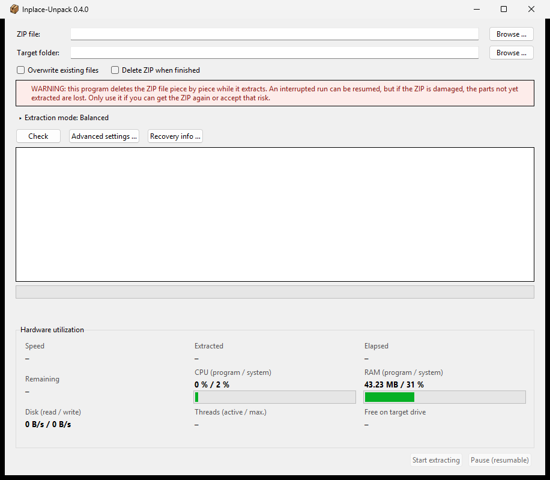

<p align="center">
  
</p>

<h1 align="center">Inplace-Unpack</h1>

<p align="center">
  Unzip a huge ZIP even when your disk doesn't have room for the ZIP <i>and</i> the files.
</p>

<p align="center">
  
  
  
  
</p>

> **Heads up:** this tool eats the ZIP while it unpacks it. If something goes wrong, the parts that were
> already unpacked are fine and the rest can be resumed, but a broken ZIP can't be "un-eaten".
> Only use it on archives you could download again.

## What's this?

I had a 160 GB ZIP and 130 GB of free space. Explorer, 7-Zip, WinRAR, `unzip`, Ark and File Roller all need
room for the archive and the extracted files at the same time, so none of them worked.

Inplace-Unpack unpacks the files in the order they sit inside the ZIP. As soon as a file is safely on disk,
the part of the ZIP it came from is handed back to the file system (sparse files on Windows, hole punching on
Linux). So you only need about as much free space as the ZIP itself, not double.



## Good for

- Google Takeout exports (photos, Drive, YouTube) on a laptop with a small SSD
- "Download as ZIP" exports from iCloud, OneDrive, Dropbox, Nextcloud or social networks
- restoring your own backup ZIPs onto a nearly full disk
- big datasets (ML, research, GIS) that come as one giant ZIP or as `.zip.001, .002, ...`
- photo and video collections handed over as ZIP

## Download

Everything is on the [Releases](https://github.com/HaswellHD/InPlace_UnPack/releases/latest) page.

**Windows 10 / 11**

- `Inplace-Unpack-Setup.exe` installs it (Start menu, optional right-click entry, no admin rights).
- `Inplace-Unpack.exe` runs without installing.

They aren't code-signed yet, so SmartScreen will probably warn you the first time ("More info" → "Run anyway").

**Linux**

- `Inplace-Unpack-x86_64.AppImage` works on pretty much any distro. Make it executable and start it:

  ```sh
  chmod +x Inplace-Unpack-x86_64.AppImage
  ./Inplace-Unpack-x86_64.AppImage                      # window
  ./Inplace-Unpack-x86_64.AppImage cli big.zip target/  # command line
  ```

- Or install a package:

  ```sh
  sudo apt install ./inplace-unpack_*_all.deb          # Debian, Ubuntu, Mint
  sudo dnf install ./inplace-unpack-*.noarch.rpm       # Fedora, RHEL
  sudo zypper install ./inplace-unpack-*.noarch.rpm    # openSUSE
  ```

  Then `inplace-unpack` opens the window and `inplace-unpack-cli` is the command line.

- NixOS: `nix run github:HaswellHD/InPlace_UnPack` (command line: `nix run github:HaswellHD/InPlace_UnPack#cli -- big.zip target/`).

**From source** (any system with Python 3.11+ and Tkinter):

```sh
git clone https://github.com/HaswellHD/InPlace_UnPack.git
cd InPlace_UnPack
python app_gui.py        # Windows
python3 app_gui.py       # Linux (or ./install-linux.sh for a menu entry, no sudo)
```

## What it does

- Frees space while unpacking: NTFS / ReFS on Windows; btrfs, ext4, xfs, f2fs, zfs, bcachefs and tmpfs on
  Linux (checked with a quick test on the actual drive, no root needed).
- Split ZIPs (`name.zip.001`, `.002`, ... like 7-Zip's "split to volumes"): each part is deleted once
  everything in it is unpacked. Works on any file system, even FAT32/exFAT. You can turn it off.
- Checks everything first: encryption, compression method, broken or malicious entries, file names, and
  whether the space will actually be enough. Nothing is touched before that check passes.
- Crash-safe. A piece of the ZIP is only released after the file is written, flushed and recorded in a
  small journal. Power cut, crash, closed window, full disk: start it again and it continues.
- Resumes on its own when you open it again, and retries after "disk full" or a temporary error.
- Damaged files inside the ZIP (CRC errors) are kept as they are, listed in `<zip>.damaged.txt`, and the
  rest keeps going (Safe mode stops instead).
- Three modes (Safe, Balanced, Performance) and a bunch of advanced settings.
- Live monitor: speed, average speed, time left, CPU, RAM, disk.
- Optional right-click entry: Explorer on Windows (Windows 11: under *Show more options*), Dolphin and
  GNOME Files on Linux. Per user, no admin rights.
- On Linux: follows your dark/light theme, uses the KDE or GNOME file dialogs, keeps the executable bit of
  files from Unix ZIPs, and understands btrfs subvolumes.
- Handles ZIP64 (files over 4 GB, more than 65,535 entries), Unicode names, Deflate, BZIP2, LZMA,
  Zstandard and Stored.
- English by default, German in the settings.
- No dependencies, no network, no telemetry, no admin rights.

## How to use it

1. Pick the ZIP (or the first part, `.zip.001`) and a target folder. Or right-click the ZIP.
2. Choose a mode if you want. Balanced is fine for most people.
3. Click **Check**. It tells you if it fits and what, if anything, is wrong.
4. Click **Start extracting** and confirm once.
5. You can pause any time. Next time you open the program it carries on by itself.

Command line:

```sh
inplace-unpack-cli ARCHIVE.zip TARGET_FOLDER [--check] [--yes] [--mode safe|balanced|performance]
                   [--config settings.json] [--threads N] [--sync-mb N] [--max-cpu PCT]
                   [--overwrite] [--delete-archive] [--name-encoding cp850] [--ignore-space]
inplace-unpack-cli status ARCHIVE.zip      # what an interrupted run left behind
inplace-unpack-cli bench [--size-mb 1024]  # try the modes on your own disk
```

Exit codes: `0` done, `1` cancelled, `2` check failed, `3` stopped but resumable.

## Modes

| | Safe | Balanced (default) | Performance |
|---|---|---|---|
| Idea | as careful as possible | fast, PC stays usable | as fast as it gets |
| Worker threads | 1 | 1 (+1 helper for big files) | 2 on Windows, up to 4 on Linux (+ helpers) |
| CPU priority | below normal | below normal | normal |
| Journal and space release every | 64 MB | 1 GB | 2 GB |
| Re-reads every file to verify it | yes | no | no |
| RAM it may use | up to 256 MB | up to 512 MB | up to 1 GB |
| Damaged entry | stops | keeps it, continues | keeps it, continues |

No matter which mode you pick, a piece of the ZIP is only freed after the file and the journal entry are on
disk. There's no setting to turn that off.

## Settings

Everything is under **Advanced settings** in the app, or in a JSON file you pass with `--config`
(see [examples/settings.example.json](examples/settings.example.json)). The app keeps its settings in
`%APPDATA%\Inplace-Unpack\settings.json` on Windows and `~/.config/Inplace-Unpack/settings.json` on Linux.
Values outside sensible limits get clamped.

The ones you'll most likely care about:

- `max_write_mb_s` caps the write speed. Best option if you want to keep using the PC while it runs.
- `priority` (idle / below_normal / normal) only affects the worker threads; the window stays snappy.
- `sync_interval_mb` sets how often the journal is written and space is released.
- `keep_damaged` decides whether a damaged entry stops the run or is kept and listed.
- `delete_parts` decides whether finished parts of a split ZIP are deleted.
- `auto_resume` / `resume_after_reboot` control what happens after an interruption.
- `explorer_menu` adds or removes the right-click entry.

The rest is explained right next to each option in the app.

## Requirements

- Windows 10 or 11 (64-bit), or a Linux desktop or server.
- The ZIP has to be on a file system that can free parts of a file: NTFS or ReFS on Windows; btrfs, ext4,
  xfs and friends on Linux. FAT32 and exFAT can't, except for split ZIPs, where whole parts are deleted.
- Target folder on the same drive as the ZIP (on Linux: the same file system or btrfs pool), otherwise
  freeing space doesn't help.
- Roughly *(unpacked size − ZIP size)* free, plus the small reserve the check shows you.
- From source: Python 3.11 or newer with Tkinter.

## How fast is it?

The disk is the limit, not the processor. On a cheap SATA SSD under Windows it ran at 60–115 MB/s with
under 10 % CPU. On a btrfs NVMe drive under Fedora it reached about 240 MB/s in Balanced and about 525 MB/s
in Performance mode. Details: [docs/Performance.md](docs/Performance.md). Run `inplace-unpack-cli bench` to
test your own disk.

## Safety

- No admin or root rights, no network access, no telemetry.
- On Windows, Defender stays on. The tool never asks for antivirus exceptions.
- Every output path is cleaned up and checked so nothing lands outside the target folder. Junctions and
  symlinks inside the target are never followed.
- Nobody else can write to the ZIP while it's being unpacked (exclusive lock).
- The journal (`<zip>.unzip-progress`) is replaced atomically and has a checksum.

More in [docs/Reliability.md](docs/Reliability.md) and [Security.md](Security.md).

## Limitations

- Not supported: encrypted ZIPs, Deflate64 (Windows Explorer uses it for some big files), 7z, RAR, tar.gz,
  and WinZip-style spanned archives (`.z01, .z02, ..., .zip`). They're rejected before anything changes.
  Multi-part 7z/RAR can't be done safely: those formats keep important data at the end or compress "solid".
- Snapshots keep the space taken: System Restore points on Windows, btrfs/ZFS snapshots (Snapper,
  Timeshift) or reflink copies on Linux. The tool notices when space doesn't come back and stops cleanly.
- Cheap USB sticks that ignore flush commands can lose data on power loss, whatever the software does.
- The ZIP keeps showing its old size. Look at "Size on disk" in Explorer, or `du -h` on Linux.
- The Windows .exe isn't signed yet, so expect SmartScreen warnings and the occasional false positive from
  an antivirus (common with PyInstaller apps).

## Building it yourself

**Windows:** double-click `build.cmd`. It sets up a local Python environment (`.venv`), installs the build
tools, runs the tests and puts `Inplace-Unpack.exe` and `inplace-unpack-cli.exe` into `dist\`. With Inno
Setup 6 installed you also get `Inplace-Unpack-Setup.exe`. `build.cmd -SkipTests` skips the tests. Signing
is optional, see [docs/Signing.md](docs/Signing.md).

**Linux:**

```sh
./packaging/build-appimage.sh   # dist/Inplace-Unpack-x86_64.AppImage (needs pyinstaller)
./packaging/build-deb.sh        # dist/inplace-unpack_<version>_all.deb
./packaging/build-rpm.sh        # dist/inplace-unpack-<version>-1.noarch.rpm (needs rpm-build)
```

**Tests:** `python -m pytest tests -q` (on Linux without a screen: `xvfb-run -a python3 -m pytest tests -q`).
The big-file test (over 4 GB, needs about 10 GB free) runs with `INPLACE_UNPACK_LARGE=1`.

Releases are built by GitHub Actions: pushing a tag like `v0.5.0` builds all Windows and Linux files and
publishes them.

## Contributing

Bug reports and pull requests are welcome, see [Contributing.md](Contributing.md).

## License

MIT, see [LICENSE](LICENSE). Uses only the Python standard library; the Windows .exe and the AppImage are
built with PyInstaller, whose license explicitly allows that for any project.
